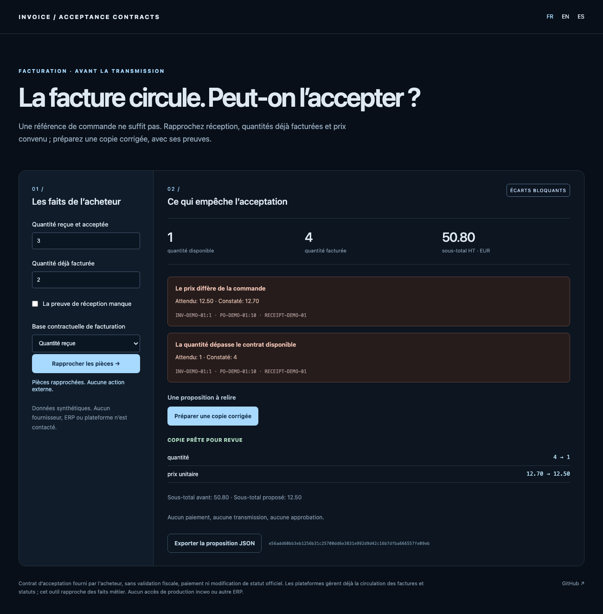

# Invoice Acceptance Contracts

[Français](README.md) · [Español](README.es.md)

**An invoice can circulate correctly while failing the buyer’s acceptance conditions.**

This lab reconciles an order, accepted receipts, prior billed quantities and an invoice. It prepares an evidence-backed corrected copy without submitting invoices, changing official statuses or authorizing payment.



## Try it

Python 3.11 or newer, standard library only.

```sh
python3 -m invoice_contract serve --lang en
```

Open `http://127.0.0.1:8768/?lang=en`. The synthetic demo has ten units ordered, three received and two previously billed: **one unit remains available**, while the invoice bills four at the wrong price. The proposed copy changes the **line subtotal from EUR 50.80 to 12.50**, then undergoes reconciliation again. It is neither a credit note, issued invoice nor approval.

```sh
python3 -m invoice_contract audit invoice_contract/examples/partial-receipt.json
python3 -m invoice_contract prepare invoice_contract/examples/partial-receipt.json > proposal.json
python3 -m invoice_contract verify-source invoice_contract/examples/partial-receipt.json proposal.json
python3 -m invoice_contract import-ubl invoice_contract/examples/invoice.xml
```

`pip install .` also provides `invoice-contract`. UI, findings and CLI messages support FR/EN/ES. `ready_for_review` only means no discrepancy was found under the supplied contract; review remains necessary.

## Explicit contract and unknown evidence

- Prices, units, currency, item and typed identifiers must match. No conversion or semantic match is invented.
- `received` limits quantity to accepted receipt minus prior billing, capped by remaining ordered quantity. `ordered` expresses another contract and does not require receipt evidence.
- Missing receipts remain **unknown**: neither confirmed delivery nor zero quantity permitting automatic correction.
- Identical evidence retries do not double quantities; conflicting content under the same identifier blocks preparation. An evidence identifier denotes one line observation, such as receipt + line, and must be unique in that context.
- Invoice lines sharing an order line are aggregated and sent to review; they cannot each consume the whole balance.
- Unresolved references show SKU candidates without choosing one. Invoice history keys are typed supplier identity + invoice number.

Quantities and prices are decimal strings. Line amounts use two-decimal `ROUND_HALF_UP`, this prototype’s declared convention. Taxes, credit notes, complex advances, charges and allowances are not modeled. Subtotal means the sum of line amounts, not the total payable amount.

## A copy for review

`prepare` may reduce a positive quantity to its evidenced balance, restore agreed price and recompute amounts. Changes cite their evidence. Identity, currency, conflicting evidence or inconsistent global references prevent automatic copies; unknowns remain unresolved. Zero remaining quantity requires human intervention.

SHA-256 binds a proposal to its source case; `verify-source` detects changed receipts or contracts. The digest proves neither identity nor human authorization. No remote executor, payment or production call exists.

## Narrow UBL import and comparison

The importer reads actual UBL `Invoice` namespaces, `schemeID` identifiers, order reference and the [buyer order-line reference](https://docs.peppol.eu/poacc/billing/3.0/syntax/ubl-invoice/cac-InvoiceLine/cac-OrderLineReference/cbc-LineID/). It rejects DTD/entities, mixed monetary currencies, allowances/charges and price base quantities other than one. It is a small line adapter: **neither a complete UBL/Peppol validator nor a Factur-X PDF/CII reader**. The XML fixture is not a complete regulatory invoice.

[ERPNext](https://docs.frappe.io/erpnext/purchase-invoice) already links purchasing/invoicing to orders and receipts. The hypothesis here is a portable, standalone, explainable contract between tools, not inventing reconciliation. [Electronic invoicing specifications](https://www.impots.gouv.fr/specifications-externes-b2b) already cover exchanges and statuses; this project does not replace them. It follows the correction to our FE-MCP research: business value must exceed status circulation.

## Validation and limits

```sh
python3 -m unittest discover -s tests -v
npm ci
npx playwright install chromium
npm run test:browser
npm run format:check
```

Fourteen tests cover missing/conflicting evidence, history, shared quantities, units/currencies, decimals and actual XML import. Browser checks FR/EN/ES, copies, export, contract changes and mobile; CI checks Python 3.11/3.12 and wheel installation outside sources. Exit 1 for discrepancies/review or changed sources, 2 for invalid input. Synthetic data only: no real buyer, supplier, accountant or ERP tested; no tax validation or SOTA superiority. MIT license; research alpha.
